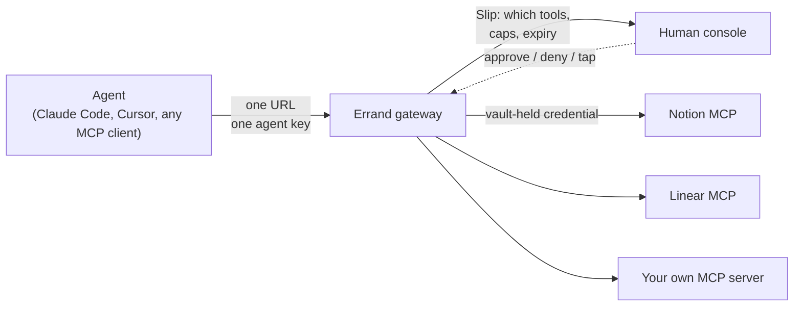

# Errand

**One doorway, one key, four tools — and a signed permission slip for every job.**

Errand is a self-hosted MCP gateway. Your agent never sees a service credential, a
connector URL or the 70 tools a service advertises. It sees one MCP endpoint with
four tools. Everything it is allowed to do is written in a **Slip**: a signed,
expiring permission document a human approves. When the agent asks for something
outside that slip, the gateway refuses before anything reaches the upstream.

Where the prompt ends, Errand begins.



- **No LLM in the gateway.** It is strict code, the only gatekeeper with no AI to trick.
- **Credentials never leave the Vault.** Connector secrets are envelope-encrypted and
  handed only to the outgoing call.
- **The journal is a hash chain.** Every decision, call and denial is append-only and
  verifiable; `GET /api/journal/verify` names the first broken entry.
- **Sends and spends wait for a human.** Sends have a cancel window; spends need a tap.

Read [`GLOSSARY.md`](GLOSSARY.md) first if you want the exact vocabulary. It is
load-bearing: a *Slip* is the permission, an *Errand* is the work, and they are not
interchangeable.

---

## Contents

1. [What the agent sees](#what-the-agent-sees)
2. [Requirements](#requirements)
3. [Install Bun](#install-bun)
4. [Quick start: the demo in three commands](#quick-start-the-demo-in-three-commands)
5. [Run it manually (development)](#run-it-manually-development)
6. [Use it from an agent](#use-it-from-an-agent)
7. [Configuration](#configuration)
8. [Deploy with Docker](#deploy-with-docker)
9. [Platform support](#platform-support)
10. [Tests and typechecks](#tests-and-typechecks)
11. [Project layout](#project-layout)
12. [Troubleshooting](#troubleshooting)
13. [Documentation](#documentation)

---

## What the agent sees

Four tools, and only the upstream tools an approved slip names.

| Tool | What it does |
|---|---|
| `errand_catalog` | Lists the tools the agent may request right now, plus the server limits. Hidden tools and decoys never appear. |
| `request_errand` | Asks for a scoped job: a goal and the exact tool names. Returns a pending slip; a human approves it. |
| `errand_status` | Reads a slip's state, remaining calls and spend, expiry, and — once approved — its capability. |
| `errand_call` | Submits one call with the capability. Reads/writes/deletes run at once; sends are held briefly; spends need a human tap. |

A call is denied, in order, for: no capability, a bad signature, a decoy, a tool
outside the slip, an unhealthy connector, a class mismatch, bad arguments, a
constraint violation, a bad spend amount, or an exhausted call/spend/rate cap.
The agent gets a precise reason; nothing is forwarded.

---

## Requirements

| Requirement | Version | Notes |
|---|---|---|
| **Bun** | **1.4.4** | The runtime for the gateway, web app, scripts and tests. Pinned in CI and both Docker images. |
| **Git** | any current release | To clone the repo. |
| **A modern browser** | current Chrome, Firefox, Safari or Edge | The human console. |
| **Docker Engine + Compose plugin** | current `docker compose` | Optional — only for the container deployment. Docker Desktop is fine for a local trial. |
| **Node.js** | 18+ | Optional. Only needed if an agent client bridges stdio through `npx mcp-remote`. |

There is **no database server to install**: the gateway uses SQLite via `bun:sqlite`
and runs its own Drizzle migrations at boot.

### Ports

| Port | Process | When |
|---|---|---|
| `8787` | gateway (`/mcp`, `/api/*`) | dev and demo |
| `5173` | web console (Vite dev server) | dev and demo |
| `4001` | mock MCP upstreams | dev and demo |
| `4173` | Vite preview | optional |
| `3000` | web console in the Docker image | container only |
| `80`, `443` | Caddy | Docker deployment only |

---

## Install Bun

Bun is the only hard dependency. Install it once per machine.

### Linux

```sh
curl -fsSL https://bun.sh/install | bash
# then open a new shell, or:
source ~/.bashrc        # zsh: source ~/.zshrc
bun --version
```

On musl/Alpine, use `curl -fsSL https://bun.sh/install | bash -s -- --musl`.

### macOS

```sh
curl -fsSL https://bun.sh/install | bash
bun --version
```

Apple Silicon and Intel are both supported. Homebrew also works:
`brew install oven-sh/bun/bun`.

### Windows

PowerShell (no admin required):

```powershell
powershell -c "irm bun.sh/install.ps1 | iex"
bun --version
```

If PowerShell blocks the script, allow it for this session only:

```powershell
Set-ExecutionPolicy Bypass -Scope Process
```

`npm install -g bun` works on every OS if you already have Node, but the native
installer is the supported path.

> **Expected on all three:** `bun --version` prints `1.4.4`. A different patch
> version usually works; the lockfile and images pin 1.4.4.

---

## Quick start: the demo in three commands

This is the fastest way to see the whole loop, including a mock calendar, a human
approval and a scoped call. It runs entirely on `127.0.0.1`; no account and no
network service is required.

```sh
git clone https://github.com/Rawknee-69/Errand.git
cd Errand
bun install          # once
bun run demo:up      # gateway :8787, web :5173, mock services :4001
```

`demo:up` prints the console URL and the owner passphrase:

```text
  Control panel    http://127.0.0.1:5173
  Owner passphrase errand-demo-passphrase
```

Open <http://127.0.0.1:5173>, sign in with `errand-demo-passphrase`, then seed the
offline calendar and an agent key:

```sh
bun run demo:seed    # in a second terminal
```

Now drive it as an agent:

```sh
bun run demo:agent -- --auto-approve
```

That prints, in order: the tools the agent may name; a request for a hidden tool
being refused; a scoped slip; an approval with a cap trim; an allowed call and its
result; an out-of-scope call refused before forwarding; and a journal verification.

Stop everything and free the ports:

```sh
bun run demo:stop
```

### Demo commands, all platforms

| Command | What it does |
|---|---|
| `bun run demo:up` | Starts mock services, gateway and web together. Writes secrets, the database and logs under `.demo/` (gitignored). |
| `bun run demo:up --fresh` | Same, with an empty database — while keeping demo guests and issued agent keys active. |
| `bun run demo:seed` | Connects the offline calendar and exposes `list_events` / `create_event`. |
| `bun run demo:agent` | Runs one agent through catalog → request → approve → call. Add `--auto-approve` to skip the tap. |
| `bun run demo:settle` | The full Settle It story. Add `--auto-approve --tap-spend` for a hands-free rehearsal. |
| `bun run demo:stop` | Stops the stack and clears orphan listeners on 8787, 5173 and 4001. |

The demo uses `DEMO_MODE=true`, `ALLOW_LOCALHOST_DEV=true` and
`SESSION_COOKIE_SECURE=false` **for localhost only**. None of those belongs in a
deployment; see [Deploy with Docker](#deploy-with-docker).

Logs: `.demo/logs/{gateway,web,mock-services}.log`.

---

## Run it manually (development)

Three processes, three terminals. This is what the demo automates.

### 1. Create your environment file

**Linux / macOS**

```sh
cp .env.example .env
```

**Windows — PowerShell**

```powershell
Copy-Item .env.example .env
```

**Windows — CMD**

```bat
copy .env.example .env
```

Generate the three secrets. This works identically on every OS with Bun:

```sh
bun -e "console.log(Buffer.from(crypto.getRandomValues(new Uint8Array(32))).toString('base64'))"
```

Run it three times, and paste the results into `.env` as `VAULT_KEY`, `HMAC_KEY`
and `JWT_SECRET`. Set `OWNER_PASSPHRASE` to a unique value of at least 12
characters.

<details>
<summary>Alternative generators (openssl, PowerShell)</summary>

Linux / macOS / Git Bash:

```sh
openssl rand -base64 32
```

PowerShell 5.1 and 7:

```powershell
$b = New-Object byte[] 32
[Security.Cryptography.RandomNumberGenerator]::Create().GetBytes($b)
[Convert]::ToBase64String($b)
```

</details>

The gateway refuses to boot if `VAULT_KEY`, `HMAC_KEY` or `JWT_SECRET` is missing
or shorter than 32 bytes, or if the passphrase is shorter than 12 characters.

### 2. Install and start the gateway

```sh
bun install
bun --env-file=.env run --cwd apps/gateway dev
```

`--env-file` matters: the gateway's dev script runs with `apps/gateway` as its
working directory, so Bun will not find the repo-root `.env` on its own.

Check it:

```sh
curl http://127.0.0.1:8787/health
# {"service":"gateway","status":"ok","version":"0.1.0"}
```

### 3. Start the web console

```sh
bun run dev:web
```

Open <http://127.0.0.1:5173> and sign in with `OWNER_PASSPHRASE`. The Vite dev
server proxies `/api/*`, `/health` and `/mcp` to the gateway. Point it at another
gateway with `GATEWAY_URL`:

```sh
GATEWAY_URL=http://127.0.0.1:9000 bun run dev:web          # Linux / macOS
$env:GATEWAY_URL="http://127.0.0.1:9000"; bun run dev:web  # PowerShell
```

### 4. Optional: mock upstreams

```sh
bun run dev:mock-services
# listening on http://127.0.0.1:4001
```

Add `http://127.0.0.1:4001/calendar/mcp` as a connector, with
`ALLOW_LOCALHOST_DEV=true` in `.env`.

### 5. Optional: an empty database

The default `DATABASE_PATH=errand.db` lives wherever the gateway process starts.
Delete the file (and its `-wal` / `-shm` siblings) to start clean.

---

## Use it from an agent

The agent endpoint is an MCP **streamable HTTP** server at `/mcp`. It
authenticates with one header:

```text
Authorization: Bearer errand_...
```

### 1. Issue an agent key

In the console, open **Keys** (or **Demo**) and create a key. The value is shown
**once**; the gateway stores only its SHA-256 hash. Revoke it from the same screen
at any time — a revoked key stops working immediately.

Automation can use `POST /api/agent-keys` with an authenticated console session:

```sh
curl -X POST http://127.0.0.1:8787/api/agent-keys \
  -H "content-type: application/json" \
  -H "cookie: errand_session=..." \
  -d '{"name":"laptop"}'
```

### 2. Point the client at the endpoint

**Claude Code** — one command:

```sh
claude mcp add --transport http errand http://127.0.0.1:8787/mcp \
  --header "Authorization: Bearer errand_YOUR_KEY"
```

**Cursor** — save as `.cursor/mcp.json` in the project (or the global config):

```json
{
  "mcpServers": {
    "errand": {
      "url": "http://127.0.0.1:8787/mcp",
      "headers": {
        "Authorization": "Bearer errand_YOUR_KEY"
      }
    }
  }
}
```

**Any client that accepts a remote MCP server** uses the same shape: the `url`,
and the `Authorization` header.

**Claude Desktop and other stdio-only clients** need a bridge. `mcp-remote`
forwards stdio to an HTTP MCP server (requires Node):

```json
{
  "mcpServers": {
    "errand": {
      "command": "npx",
      "args": [
        "-y",
        "mcp-remote",
        "http://127.0.0.1:8787/mcp",
        "--header",
        "Authorization: Bearer errand_YOUR_KEY"
      ]
    }
  }
}
```

Replace `http://127.0.0.1:8787` with `https://your-host` in a deployment. The demo
console generates both the Claude Code command and the Cursor JSON with the right
URL and key already filled in.

### 3. Give the agent a narrow prompt

The point is that the prompt asks and the gateway enforces, so keep the prompt
explicit about the job and the tools:

```text
You are working through Errand, my MCP doorway. Use only the Errand tools:
errand_catalog, request_errand, errand_status, errand_call. You have no other
credential or connector URL.

Goal: Summarise this week's calendar

Required tools for this job: calendar__list_events.

1. Call errand_catalog only to confirm those tools are there. Do not request
   every tool you can see.
2. Call request_errand with exactly the required tools above and limits
   { "calls": 6 }. Do not add a tool "just in case".
3. Stop and tell me it is pending. I will approve the slip in Errand.
4. After I say approved, call errand_status to collect the capability, then
   errand_call one call at a time.
5. If a tool is not on the slip, stop. Do not retry, widen the request, or look
   for another route.
```

### 4. Approve the slip

**Slips** shows a plain-language card: the goal, the tools, *It can* / *It
cannot*, call and spend caps, and the expiry. Tighten the caps if you want, then
approve. The agent's next `errand_status` returns a capability that admits that
slip and nothing else.

A send is held for a short cancel window. A spend shows **needs your tap** and
moves only after **Confirm spend**. Both appear in the live feed and the journal.

### 5. Watch what happened

**Receipts** says what ran and what the verifier found (`matched`, `mismatched`,
`unverified`), with an undo where a real inverse exists. **Trace** shows every
journal row with the exact message and output; **Verify the chain** reports the
event count or the first broken sequence.

---

## Configuration

All settings come from the environment. `.env.example` documents each one; the
gateway validates them at boot.

| Variable | Required | Default | Meaning |
|---|---|---|---|
| `VAULT_KEY` | yes | — | Key-encryption key for connector credentials. **≥32 bytes.** Back it up separately from the database; losing it makes every stored credential unrecoverable. |
| `HMAC_KEY` | yes | — | Signs slips and capabilities. **≥32 bytes.** Changing it invalidates existing slips. |
| `JWT_SECRET` | yes | — | Signs session cookies. **≥32 bytes.** |
| `OWNER_PASSPHRASE` | yes | — | The single owner's console passphrase. **≥12 characters.** |
| `VAULT_KEY_PREVIOUS` | no | unset | Comma-separated older key material, kept only while rotating. |
| `PORT` | no | `8787` | Gateway port. |
| `DATABASE_PATH` | no | `errand.db` | SQLite file. `:memory:` is used by tests. |
| `DEMO_MODE` | no | `false` | Enables the journaled demo guest picker. Off anywhere but a demo. |
| `SESSION_COOKIE_SECURE` | no | `true` | `false` only for plain-http localhost. |
| `SESSION_TTL_HOURS` | no | `12` | Console session lifetime. |
| `ALLOW_LOCALHOST_DEV` | no | `false` | Allows plain-`http://` loopback MCP servers. Off in production. |
| `EGRESS_TIMEOUT_MS` | no | `15000` | DNS + connect + response deadline for an outbound request. |
| `EGRESS_MAX_RESPONSE_BYTES` | no | `10485760` | Response cap; larger bodies are refused or truncated. |
| `MAX_CONNECTORS_PER_USER` | no | `10` | Connector quota. |
| `CALL_TIMEOUT_MS` | no | `15000` | One upstream tool call, including the MCP handshake. |
| `CONNECTOR_CONCURRENCY` | no | `2` | In-flight calls per connector in this process. |
| `OAUTH_REDIRECT_URI` | no | `http://127.0.0.1:8787/api/oauth/callback` | Must match the provider's registered callback exactly. |
| `WEB_ORIGIN` | no | unset | Public web origin; after OAuth the browser is sent to `/connectors` there. |
| `SITE_ADDRESS` | compose only | `localhost` | Public hostname Caddy obtains a certificate for. Bare hostname, no scheme. |

The agent-facing limits are compiled in (`@errand/shared`): 20 tools per errand,
50 calls, 20 calls/minute, $200 spend and 30 minutes per slip. They are clamps,
not config.

> **Keep `.env` out of git.** It is already in `.gitignore` and `.dockerignore`.
> Rotate anything that ever appeared in a commit, a log or a chat message.

---

## Deploy with Docker

The deployment is four containers behind one Caddy hostname. Only Caddy publishes
ports; the gateway and web app are reached on the internal compose network. See
[`docs/RUNBOOK.md`](docs/RUNBOOK.md) for operations and
[`docs/DEPLOYMENT.md`](docs/DEPLOYMENT.md) for host hardening.

### Linux (documented production path)

Prerequisites: Docker Engine + Compose plugin, a DNS `A`/`AAAA` record pointing at
the host, and ports 80/443 open.

```sh
git clone https://github.com/Rawknee-69/Errand.git
cd Errand
cp .env.example .env
chmod 600 .env
```

Fill `.env`:

```sh
openssl rand -base64 32   # VAULT_KEY
openssl rand -base64 32   # HMAC_KEY
openssl rand -base64 32   # JWT_SECRET
```

Set `OWNER_PASSPHRASE` (12+ characters) and `SITE_ADDRESS` to the bare hostname,
for example `errand.example.com`. Then:

```sh
docker compose up -d --build
docker compose ps
curl -fsS "https://$SITE_ADDRESS/api/auth/session"
```

`/mcp` and `/api/*` (including `/api/oauth/callback`) go to the gateway;
everything else is the web app.

### Windows and macOS (local trial)

Docker Desktop provides the engine and the Compose plugin. The commands are the
same in PowerShell:

```powershell
Copy-Item .env.example .env
# fill the three secrets and OWNER_PASSPHRASE, set SITE_ADDRESS=localhost
docker compose up -d --build
docker compose ps
```

Then open <https://localhost>. With `SITE_ADDRESS=localhost` Caddy uses its
internal CA, so the browser warns; accept it for the trial only.

Two things to know on desktop systems:

- **Ports 80/443 must be free.** Stop anything else bound to them (IIS, another
  proxy, some VPN tools).
- **The hardening guide is Linux-specific** (UFW, unattended upgrades, systemd).
  Docker Desktop is fine for a local trial and for development, not for a public
  production host.

### Backups

Litestream streams the SQLite WAL into the `errand-replica` volume. Credentials in
that copy are ciphertext and `VAULT_KEY` is not in it. Still keep the volume
private, and store `VAULT_KEY` in a password manager — **losing it means every
connector must be authorised again**.

---

## Platform support

The core is Bun + TypeScript, so the gateway, web console, shared package, tests
and demo scripts run on all three platforms.

| Surface | Linux | macOS | Windows |
|---|---|---|---|
| Gateway, web, shared, mock services | Yes (CI) | Yes (expected) | Yes (used for development) |
| `bun run demo:*` (TypeScript) | Yes | Yes | Yes — `demo:stop` uses `taskkill` and PowerShell to free ports |
| `bun test`, `bun run typecheck` | Yes (CI) | Yes | Yes |
| Docker Compose stack | Yes (documented) | Docker Desktop, local trial | Docker Desktop, local trial |
| `scripts/*.sh`, `deploy/drive.sh` | Yes | Yes | Use WSL or Git Bash |
| Browser console | Yes | Yes | Yes |

What is actually exercised: CI runs the full suite and the compose stack on
Ubuntu; development and the compose CLI checks are done on Windows. macOS is
expected to work through the same Bun runtime, but is not covered by CI — if you
hit a macOS-specific issue, it is a bug worth filing.

---

## Tests and typechecks

```sh
bun test          # 445 tests across 58 files
bun run typecheck # every workspace, then the repo checks
```

`bun run typecheck` runs each package's `tsc --noEmit`, then
[`scripts/check.ts`](scripts/check.ts), which discovers every check in
[`scripts/checks/`](scripts/checks):

| Check | Enforces |
|---|---|
| `no-any` | No `any`, `@ts-ignore` or `as unknown as` in first-party code. |
| `comments` | No unreferenced TODO/FIXME/HACK, no commented-out code, no comment-heavy file. |
| `installed` | `node_modules` exists in this worktree — otherwise fail once with `bun install` as the fix. |
| `journal-events` | Journal writes go through the typed event catalogue, never a raw append. |
| `journal-last-event` | Tests select a journal event by type, never by position. |
| `oauth-verifier` | The PKCE verifier stays in the Vault, not in the `oauth_attempts` row. |

A failing check is a build failure. Fix the cause, not the check.

---

## Project layout

```text
apps/
├── gateway/          # Hono + MCP server: policy, vault, connectors, journal
│   ├── src/agent/        # the four agent tools and the forwarder
│   ├── src/policy/       # admission, caps, capability, burn, trust
│   ├── src/connectors/   # discovery, catalog, upstream calls, OAuth
│   ├── src/vault/        # envelope encryption and credential use
│   ├── src/db/           # schema, journal, scoped reads, event catalogue
│   └── src/receipts/     # verifier adapters and undo
├── web/              # React console: Slips, Catalog, Connectors, Receipts, Trace
├── mock-services/    # local MCP upstreams for tests and the demo
packages/
└── shared/           # schemas, limits, journal payloads, exposure rule
scripts/              # demo runner, checks, settle-it story
docs/                 # runbook, deployment, demo script, ADRs, proof artifacts
```

Module vocabulary and the rules live in [`GLOSSARY.md`](GLOSSARY.md) and
[`docs/adr/`](docs/adr). The short version: one home per behaviour, types over
comments, and a correction becomes a check rather than a paragraph.

---

## Troubleshooting

| Symptom | Cause and fix |
|---|---|
| Gateway exits on boot with `Invalid gateway configuration` | A secret is missing or shorter than 32 bytes, or the passphrase is under 12 characters. Regenerate and restart. |
| `EADDRINUSE` on 8787, 5173 or 4001 | An old demo is still running. `bun run demo:stop`. |
| Console loads but every request is 401 | Sign in again; the session cookie expired. Check `SESSION_COOKIE_SECURE` matches the scheme (false only for plain-http localhost). |
| `demo:up` starts but the agent sees no tools | Catalog → the tool's **requestable** switch. A changed upstream definition also blocks it until re-approved. |
| OAuth returns to a dead page | `OAUTH_REDIRECT_URI` must match the provider registration and the running gateway exactly; in dev that is `http://127.0.0.1:8787/api/oauth/callback`, with `WEB_ORIGIN=http://127.0.0.1:5173`. |
| The agent says the slip is pending | Approve it in **Slips**. `demo:agent` polls for three minutes. |
| A spend is stuck at `needs_human` | Confirm it in **Slips** → **Confirm spend**. That is the only path that moves money. |
| Journal verify reports `ok: false` | Treat it as an incident: copy the database aside, stop writing, and inspect `firstBrokenSeq`. |
| `docker compose up` cannot get a certificate | The DNS record must point at the host and ports 80/443 must be reachable. `SITE_ADDRESS=localhost` only works for a local trial. |
| PowerShell refuses the Bun installer | `Set-ExecutionPolicy Bypass -Scope Process`, then retry. |

---

## Documentation

| Document | What it covers |
|---|---|
| [`GLOSSARY.md`](GLOSSARY.md) | Slip, Errand, Connector, Catalog, Receipt, Trust, Tier — the exact vocabulary. |
| [`docs/DEMO.md`](docs/DEMO.md) | The six-minute demo script and the Settle It story. |
| [`docs/RUNBOOK.md`](docs/RUNBOOK.md) | Operating the single-box deployment: boot, login, connectors, journal, backups, restore. |
| [`docs/DEPLOYMENT.md`](docs/DEPLOYMENT.md) | Host hardening: SSH, firewall, updates, headers, key custody, container posture. |
| [`docs/VERSIONS.md`](docs/VERSIONS.md) | Every pinned dependency and the image tags, with evidence. |
| [`docs/agents/workflow.md`](docs/agents/workflow.md) | Branching, proof review, coding standards — how changes land. |
| [`docs/adr/`](docs/adr) | Decisions this project should not re-litigate. |

---

**Errand is a valet key, not a firewall.** It does not sandbox the upstream
service and it cannot undo a send or a payment. It makes the agent's permission a
thing a human signed, and it keeps the evidence of what actually happened.
